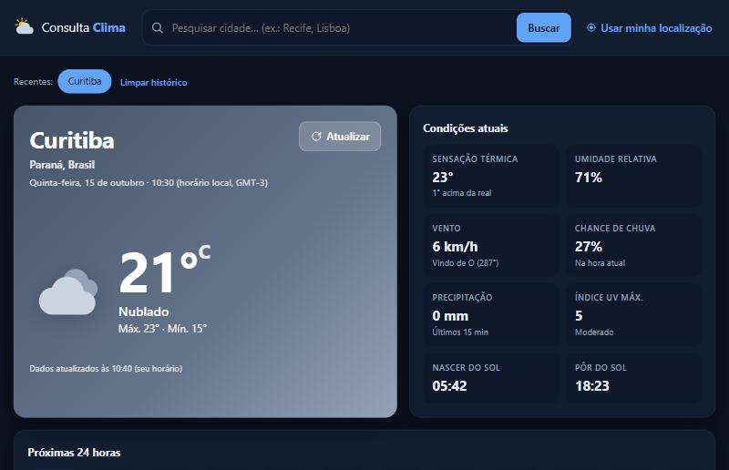

# Consulta Clima

Aplicação web de previsão do tempo: pesquise uma cidade e veja as **condições atuais**, as **próximas 24 horas** e os **próximos 7 dias**, com dados reais da API pública [Open-Meteo](https://open-meteo.com/).

- **Aplicação publicada:** https://theusiiin.github.io/consulta-clima/
- **Repositório:** https://github.com/Theusiiin/consulta-clima



## Funcionalidades

- Pesquisa de cidades pelo nome, com **sugestões** (bandeira, estado e país), navegação por teclado e *debounce*.
- Temperatura atual, **sensação térmica**, condição com **descrição e ícone**, **umidade**, **vento** (velocidade e direção), **probabilidade de precipitação**, precipitação recente, índice UV máximo, nascer e pôr do sol.
- Previsão **hora a hora** (24 h) e **diária** (7 dias) com mínimas e máximas e barra de amplitude térmica.
- Cidade e país selecionados, horário local da cidade e horário da última atualização.
- Botão **Atualizar**; se a atualização falhar, os últimos dados continuam visíveis com um aviso.
- **Geolocalização opcional**: só é solicitada quando você clica em “Usar minha localização”; se a permissão for negada, a busca manual continua disponível. A localização não é armazenada.
- Cidades recentes e reabertura da última cidade consultada (no `localStorage` do navegador).
- Indicadores de carregamento e tratamento de erros: falha de rede, tempo esgotado, API indisponível ou resposta inválida, cidade não encontrada e termo curto demais.
- Layout responsivo, tema claro/escuro automático, foco visível e respeito a “reduzir movimento”.

O app **nunca exibe dados fictícios**: se a API falhar, uma mensagem explica o problema e oferece “Tentar novamente”.

## Fonte de dados

| API | Endpoint | Uso |
| --- | --- | --- |
| Geocoding API | `https://geocoding-api.open-meteo.com/v1/search` | busca de cidades (`language=pt`) |
| Forecast API | `https://api.open-meteo.com/v1/forecast` | `current`, `hourly` (24 h) e `daily` (7 dias), `timezone=auto` |

As APIs não exigem chave. Condições do plano gratuito: **uso não comercial**, até 10.000 chamadas/dia (5.000/hora, 600/minuto) e atribuição sob **CC BY 4.0** — o rodapé do app traz a atribuição. Os códigos de tempo seguem a tabela WMO documentada pela Open-Meteo.

## Tecnologias

React 19 · TypeScript · Vite · Vitest · oxlint · GitHub Actions/Pages. Sem bibliotecas de UI: ícones meteorológicos em SVG próprios.

## Estrutura

```
src/
├── lib/
│   ├── api.ts            # chamadas à Open-Meteo, timeout, validação das respostas e erros
│   ├── weatherCodes.ts   # códigos WMO → descrição em português e ícone
│   ├── format.ts         # horas locais, dias da semana, vento, UV
│   ├── storage.ts        # última cidade e recentes (localStorage)
│   └── *.test.ts
├── hooks/useWeather.ts   # estado da consulta e cancelamento de requisições obsoletas
├── components/           # SearchBox, ForecastView, WeatherIcon
└── App.tsx
```

## Pré-requisitos

Node.js 20+ (testado com Node 24 LTS) e npm.

## Instalação e execução

```bash
npm install
npm run dev       # http://localhost:5173
```

## Testes

```bash
npm test          # 22 testes: parsing da API, erros de rede/HTTP, URLs, formatação e códigos WMO
npm run lint
npm run build
```

## Variáveis de ambiente

Nenhuma — a Open-Meteo não exige chave para uso não comercial.

## Deploy

O workflow [`.github/workflows/deploy.yml`](.github/workflows/deploy.yml) testa, gera o build e publica no **GitHub Pages** a cada push na `main` (Settings → Pages → Source: GitHub Actions). O build usa `base: './'` e funciona em qualquer hospedagem estática.

## Limitações conhecidas

- Previsões são resultados de modelos numéricos e podem divergir do observado.
- “Chance de chuva agora” usa a probabilidade da hora corrente; algumas regiões não têm esse dado e o app exibe “Indisponível”.
- Ao usar a geolocalização, o nome do local não é exibido (a Open-Meteo não oferece geocodificação reversa); são mostradas as coordenadas.
- Uso comercial exige um plano pago da Open-Meteo.
- Unidades fixas em °C, km/h e mm.

## Autor

Matheus Bonfatti — [LinkedIn](https://www.linkedin.com/in/matheus-bonfatti-lara-73a78a235/) · [GitHub](https://github.com/Theusiiin)
